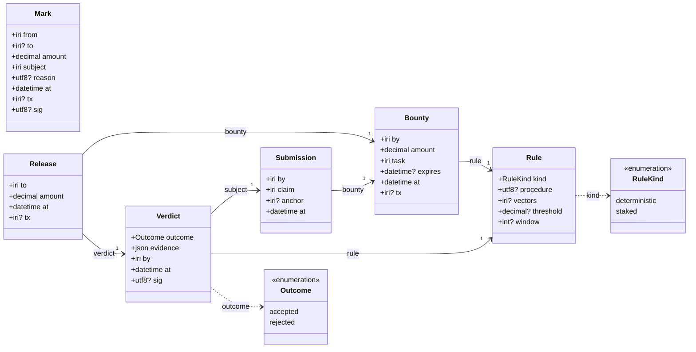

# Marking

Marking as data. The [2014 wiki](https://github.com/project-bitmark/marking/wiki)
describes marks as spendable reputation: "giving someone a mark for something
they have created, offered, or shared", where "marks are a limited resource,
the process of marking transfers ownership of the marks from one user to
another". A like is free; a mark is spent. That is what makes marks an honest
measure of value, and what makes them usable as a grade.

This repository writes the objects down in JSON-LD, one module each, with a
captured instance per object and the rules that tie them together. Term IRIs
resolve under `https://bitmark.co/marking/`.

## The five objects

| object | what it is | module |
|---|---|---|
| **Mark** | a transfer of marks with a subject: who, to whom, how much, for what IRI | [schema/mark.jsonld](schema/mark.jsonld) |
| **Bounty** | marks locked against a task, naming the rule that will judge it | [schema/bounty.jsonld](schema/bounty.jsonld) |
| **Submission** | an anchored claim that the task is done: a gitmarked commit, a Web State | [schema/submission.jsonld](schema/submission.jsonld) |
| **Verdict** | one judgement of one submission under one rule, signed, with its evidence | [schema/verdict.jsonld](schema/verdict.jsonld) |
| **Release** | the bounty paid to the submitter, citing the accepted verdict | [schema/release.jsonld](schema/release.jsonld) |

The first is the wiki's mark. The other four are the loop its Automation
section describes, "a number of marks can be staked against the action ...
submit it for approval by the community, if accepted the stake is released",
with the one thing it left unspecified filled in: how approval is decided.

## Class diagram

Generated from the schema by `node tools/gen-class-diagram.js`; also as [SVG](class-diagram.svg).

<!-- class-diagram:start -->

<!-- class-diagram:end -->

## Two kinds of rule, nothing in between

A bounty names its rule when it is posted, so the grader is fixed before
anyone works. A rule is one of:

- **deterministic**: anyone can rerun it from the submission and the rule's
  vectors and must get the same outcome. A test suite, a node accepting a
  transaction, a hash matching. The verdict is a cache, not an authority.
- **staked**: decided by marks for and against within a window. Spam is
  expensive because every vote is a mark at risk.

Deterministic rules grade what has a right answer. Staked rules grade what
only has a valued answer.

## Vectors

`vectors/` holds one instance of each object, captured from the first real
pass of the loop: a bounty on a
[bitcoin-kernel policy overlay](https://github.com/bitcoin-kernel/kernel/issues/10),
the [pull request](https://github.com/bitcoin-kernel/kernel/pull/15) that
closed it, a deterministic verdict from the kernel's test suite, and the
release. None of the marks are on chain yet, so every `tx` is absent; the
objects are valid, the transfers are pending. The plain mark is one given to
the wiki's author for writing this down in 2014.

## Tests

```
npm test
```

Zero dependencies. Checks that every module is well formed, that every vector
fits its Struct exactly, and that the four loop vectors link into one chain
under the bounty's rule.

## Related

- [bitcoin-kernel](https://bitcoin-kernel.com/): the deterministic rules and
  vectors the first bounty was graded by; `txo:` IRIs for on-chain references.
- [gitmark](https://github.com/solidpayorg/gitmark): anchors a commit in a
  transaction, which is what a code Submission's `anchor` points at.
- [torrent-schema](https://torrent-schema.github.io/): the `bts:` meta vocabulary
  (Module, Struct, Enumeration, RuleSet) these modules are written in.
